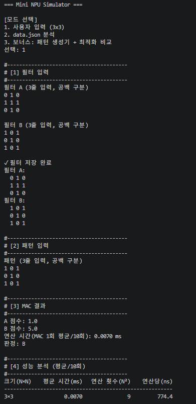
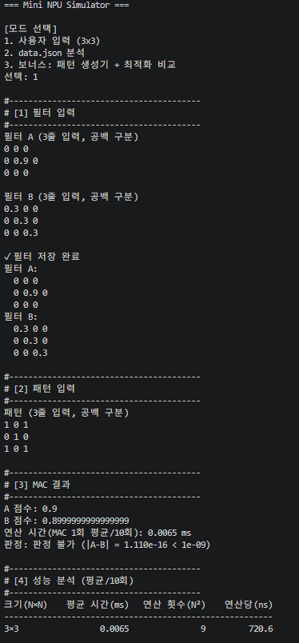
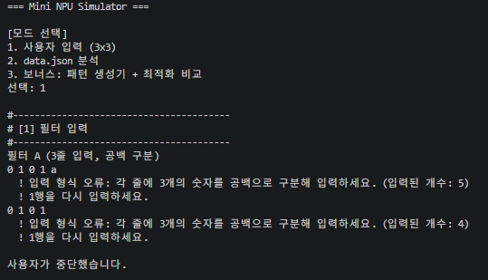
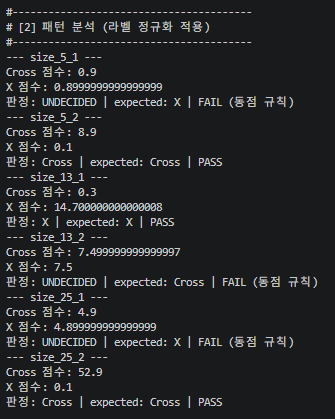
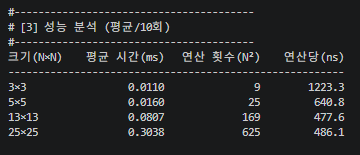
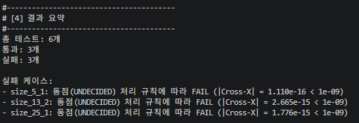
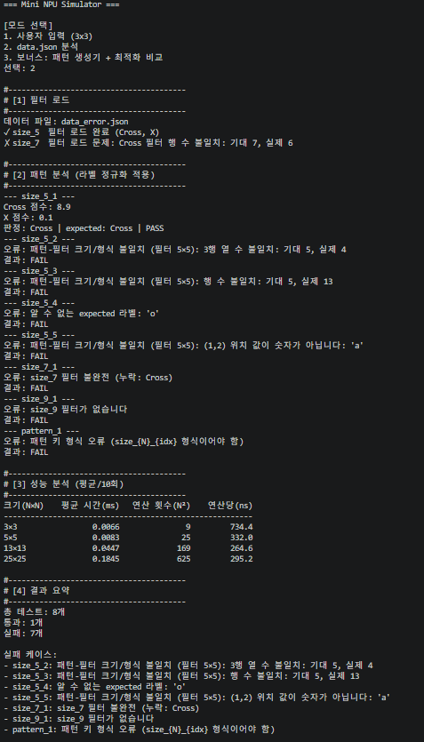
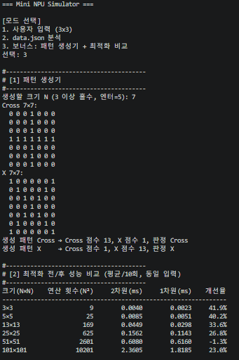

# E1-3_mini-npu-simulator
AI가 계산하는 방식을 흉내 내는 작은 계산기 만들기

## Mini NPU Simulator

AI가 계산하는 방식인 **MAC(Multiply-Accumulate) 연산**을 흉내 내는 작은 계산기입니다.
입력 패턴과 필터를 같은 위치끼리 곱하고, 그 결과를 모두 더해 유사도 점수를 구합니다. 그 점수로 패턴이 **십자가(Cross)**인지 **X**인지 판정합니다.

- 언어: Python 3.8 이상
- 사용 라이브러리: 표준 라이브러리만 사용 (`json`, `time`, `re`, `math`, `argparse`, `unicodedata`)
- 제출물: `main.py`, `README.md` (보조 파일: `data.json`, `data_error.json`, `docs/screenshots/`)

---

## 1. 실행 방법

```bash
python main.py                         # data.json은 main.py와 같은 폴더에서 읽음
python main.py --data data_error.json  # 다른 JSON 파일로 모드 2 실행 (오류 처리 시연용)
```

실행하면 모드를 고르는 메뉴가 나옵니다.

| 선택 | 모드 | 흐름 |
|---|---|---|
| 1 | 사용자 입력 (3×3) | 필터 A, B 입력 → 저장 확인 → 패턴 입력 → MAC 연산 → 판정 → 성능 분석(3×3) |
| 2 | data.json 분석 | 필터 로드 → 패턴 로드·검증 → MAC·판정·PASS/FAIL → 성능 분석(3/5/13/25) → 결과 요약 |
| 3 | 보너스 | 패턴 생성기(N×N Cross/X) → 2차원 vs 1차원 MAC 성능 비교 |

`data.json`이 없거나 JSON 문법이 깨져 있으면 안내 메시지를 출력하고 모드 2만 종료합니다. 프로그램 전체가 비정상 종료되지는 않습니다.

---

## 2. 구현 요약

### 2.1 데이터 구조
- 패턴과 필터는 모두 `list[list[float]]` 형태의 n×n 2차원 배열입니다.
- `make_matrix`, `get_value`, `set_value`로 특정 위치의 값을 저장하고 읽습니다. 3×3부터 25×25까지 크기에 제한 없이 처리하고, 보너스 모드에서는 101×101까지 확인했습니다.
- JSON에서 읽은 값은 `to_matrix(raw, n)`가 검증합니다. 행 수, 각 행의 열 수, 숫자 여부(`bool`, 문자열, NaN, inf는 거부)를 확인한 뒤 float 행렬로 바꿉니다.

### 2.2 라벨 정규화
프로그램 내부에서는 **표준 라벨 `Cross`, `X` 두 가지만** 사용합니다. 외부 표기는 `normalize_label()` 한 곳에서만 변환합니다.

```python
LABEL_ALIASES = {"+": "Cross", "cross": "Cross", "x": "X"}

def normalize_label(raw):
    if not isinstance(raw, str):
        return None
    return LABEL_ALIASES.get(raw.strip().lower())   # 모르는 라벨이면 None
```

- expected 값 `'+'`와 `'x'`, 필터 키 `'cross'`와 `'x'`가 모두 이 함수를 거칩니다.
- 대소문자와 앞뒤 공백을 무시하므로 `'Cross'`, `' X '`도 같은 라벨로 처리합니다.
- 알 수 없는 라벨은 `None`을 반환합니다. 그러면 해당 케이스는 **FAIL로 처리하고 사유를 기록**합니다. 예외를 던지지 않습니다.
- 콘솔 출력과 PASS/FAIL 비교는 모두 정규화된 표준 라벨로 합니다.

### 2.3 MAC 연산
NumPy 같은 외부 라이브러리 없이 이중 반복문으로 직접 구현했습니다.

```python
def mac(pattern, filt):
    n = len(pattern)
    total = 0.0
    for i in range(n):
        for j in range(n):
            total += pattern[i][j] * filt[i][j]   # 위치별 곱셈 → 누적
    return total                                  # 점수(float) 반환
```

### 2.4 동점 처리 정책 (epsilon)
```python
EPSILON = 1e-9
def compare_scores(a, b, eps=EPSILON):
    if abs(a - b) < eps:
        return None          # 동점
    return "A" if a > b else "B"
```
- 모드 1: 동점이면 `판정 불가`를 출력합니다.
- 모드 2: 동점이면 `UNDECIDED`를 출력하고 **FAIL로 집계**합니다.

### 2.5 모드 2 케이스 처리 순서
`analyze_case()`는 아래 순서로 검사하고, 처음 걸리는 문제를 사유로 남깁니다. 모든 단계가 케이스 단위로 격리되어 있어서 한 케이스가 실패해도 나머지 케이스 분석은 계속됩니다.

1. 키 `size_{N}_{idx}`에서 N 추출 (정규식 `^size_(\d+)_(\d+)$`)
2. expected 라벨 정규화
3. `filters[N]` 선택, Cross와 X 필터가 모두 있는지 확인
4. 패턴이 N×N인지, 값이 모두 숫자인지 검증
5. MAC으로 두 점수 계산 → epsilon 비교 → expected와 비교해 PASS/FAIL 결정

### 2.6 성능 측정
- `time.perf_counter()`로 **`mac()` 호출 구간만** 잽니다. 첫 호출은 워밍업으로 빼고, 이어서 10회를 측정해 1회 평균(ms)을 냅니다.
- 행렬 입력, 파일 읽기, 출력은 모두 측정 구간 밖에서 처리합니다.
- 성능 표의 입력은 크기마다 같은 조건이 되도록 생성기로 만든 Cross 패턴을 씁니다. 필터는 data.json에 있으면(5/13/25) 그 필터를, 없으면(3×3) 생성기 필터를 씁니다.

---

## 3. 실행 결과

### 3.1 모드 1: 정상 판정
십자가 필터(A), X 필터(B), X 패턴을 입력한 경우입니다.



```
A 점수: 1.0
B 점수: 5.0
연산 시간(MAC 1회 평균/10회): 0.0070 ms
판정: B
```

### 3.2 모드 1: 허용오차 내 동점 → 판정 불가
A는 중앙 한 칸만 0.9, B는 대각선 세 칸이 0.3인 필터입니다. 패턴은 X입니다. 수학적으로는 두 점수가 모두 0.9인데, 0.3을 세 번 더하는 과정에서 오차가 생깁니다.

```
필터 A          필터 B          패턴
0 0   0         0.3 0   0       1 0 1
0 0.9 0         0   0.3 0       0 1 0
0 0   0         0   0   0.3     1 0 1
```



```
A 점수: 0.9
B 점수: 0.8999999999999999
판정: 판정 불가 (|A-B| = 1.110e-16 < 1e-09)
```

### 3.3 모드 1: 입력 오류 → 재입력
열 개수가 부족한 줄, 숫자가 아닌 값이 섞인 줄, 열 개수가 넘치는 줄을 차례로 입력한 경우입니다. 잘못 입력한 **그 행만** 다시 입력받습니다.



```
필터 A (3줄 입력, 공백 구분)
0 1
  ! 입력 형식 오류: 각 줄에 3개의 숫자를 공백으로 구분해 입력하세요. (입력된 개수: 2)
  ! 1행을 다시 입력하세요.
0 1 a
  ! 입력 형식 오류: 'a'은(는) 숫자가 아닙니다. 숫자만 입력하세요.
  ! 1행을 다시 입력하세요.
```

### 3.4 모드 2: data.json 분석



| 케이스 | Cross 점수 | X 점수 | 판정 | expected | 결과 |
|---|---|---|---|---|---|
| size_5_1 | 0.9 | 0.8999999999999999 | UNDECIDED | X | FAIL (동점 규칙) |
| size_5_2 | 8.9 | 0.1 | Cross | Cross | PASS |
| size_13_1 | 0.3 | 14.700000000000008 | X | X | PASS |
| size_13_2 | 7.499999999999997 | 7.5 | UNDECIDED | Cross | FAIL (동점 규칙) |
| size_25_1 | 4.9 | 4.899999999999999 | UNDECIDED | X | FAIL (동점 규칙) |
| size_25_2 | 52.9 | 0.1 | Cross | Cross | PASS |

### 3.5 모드 2: 성능 분석



| 크기(N×N) | 평균 시간(ms) | 연산 횟수(N²) | 연산당(ns) |
|---|---|---|---|
| 3×3 | 0.0110 | 9 | 1223.3 |
| 5×5 | 0.0160 | 25 | 640.8 |
| 13×13 | 0.0807 | 169 | 477.6 |
| 25×25 | 0.3038 | 625 | 486.1 |

### 3.6 모드 2: 결과 요약



```
총 테스트: 6개
통과: 3개
실패: 3개

실패 케이스:
- size_5_1: 동점(UNDECIDED) 처리 규칙에 따라 FAIL (|Cross-X| = 1.110e-16 < 1e-09)
- size_13_2: 동점(UNDECIDED) 처리 규칙에 따라 FAIL (|Cross-X| = 2.665e-15 < 1e-09)
- size_25_1: 동점(UNDECIDED) 처리 규칙에 따라 FAIL (|Cross-X| = 1.776e-15 < 1e-09)
```

### 3.7 모드 2: 의도적 오류 데이터 (`data_error.json`)
제공된 data.json에는 스키마 오류가 없습니다. 그래서 오류 처리를 확인하려고 의도적인 오류만 모은 `data_error.json`을 따로 만들었습니다.



| 케이스 | 넣은 오류 | 출력된 FAIL 사유 |
|---|---|---|
| (필터) size_7 | Cross 필터가 6행 | `Cross 필터 행 수 불일치: 기대 7, 실제 6` |
| size_5_1 | 정상 케이스 (대조군) | PASS |
| size_5_2 | 3행이 4열 | `3행 열 수 불일치: 기대 5, 실제 4` |
| size_5_3 | 5×5 키에 13×13 입력 | `행 수 불일치: 기대 5, 실제 13` |
| size_5_4 | expected `'o'` | `알 수 없는 expected 라벨: 'o'` |
| size_5_5 | 값에 문자열 `"a"` | `(1,2) 위치 값이 숫자가 아닙니다: 'a'` |
| size_7_1 | 필터 일부가 로드 실패 | `size_7 필터 불완전 (누락: Cross)` |
| size_9_1 | size_9 필터 없음 | `size_9 필터가 없습니다` |
| pattern_1 | 키 형식 오류 | `패턴 키 형식 오류` |

8건 모두 프로그램이 중단되지 않고, 케이스 단위로 FAIL과 사유가 기록됩니다. 결과는 총 8개, 통과 1개, 실패 7개입니다.

---

## 4. 결과 리포트

### 4.1 실패 원인 분석

data.json 분석 결과는 **6건 중 3건 PASS, 3건 FAIL**입니다. FAIL 3건(size_5_1, size_13_2, size_25_1)은 모두 같은 원인입니다.

**(1) 원인 분류: 데이터/스키마 문제도, 로직 문제도 아닙니다. 수치 비교 정책에 따른 의도된 FAIL입니다.**
- 데이터/스키마: 키 형식, 필터와 패턴 크기, 라벨 표기가 모두 정상입니다. 라벨은 `'+'`와 `'x'`만 쓰였고 정규화로 모두 처리됩니다.
- 로직: 나머지 3건은 PASS이고, MAC 결과를 손으로 계산한 값과 비교해도 일치합니다.
- 수치 비교: 세 케이스 모두 두 점수의 차이가 `1e-16 ~ 3e-15` 수준입니다. epsilon(`1e-9`)보다 훨씬 작아서 동점으로 판정되고, 요구사항에 따라 UNDECIDED, 곧 FAIL이 됩니다.

**(2) 동점이 생기는 이유: 필터 가중치가 두 점수가 정확히 같아지도록 설계되어 있습니다.**

| 케이스 | 정답 필터 점수 | 반대쪽 필터 점수 | 실수 연산 결과 |
|---|---|---|---|
| size_5_1 (X 패턴) | X 필터: 0.1 × 9칸 = 0.9 | Cross 필터: 중앙 0.9 × 1칸 = 0.9 | 0.8999999999999999 vs 0.9 |
| size_13_2 (Cross 패턴) | Cross 필터: 0.3 × 25칸 = 7.5 | X 필터: 중앙 7.5 × 1칸 = 7.5 | 7.499999999999997 vs 7.5 |
| size_25_1 (X 패턴) | X 필터: 0.1 × 49칸 = 4.9 | Cross 필터: 중앙 4.9 × 1칸 = 4.9 | 4.899999999999999 vs 4.9 |

수학적으로는 완전한 동점입니다. 그런데 `0.1`과 `0.3`은 2진수로 정확히 표현할 수 없는 수입니다. 여러 번 더하는 동안 반올림 오차가 쌓여서 마지막 자리만 달라집니다.

**(3) epsilon 없이 `>`로만 비교했다면?**

| 케이스 | 단순 비교 판정 | expected | 결과 |
|---|---|---|---|
| size_5_1 | Cross (0.9 > 0.8999…) | X | FAIL |
| size_13_2 | X (7.5 > 7.4999…) | Cross | FAIL |
| size_25_1 | Cross (4.9 > 4.8999…) | X | FAIL |

이 경우에도 3건 모두 FAIL입니다. 더 나쁜 점은 **오차가 어느 방향으로 났느냐에 따라 판정이 갈린다**는 것입니다. 덧셈 순서만 바꿔도 결과가 뒤집힐 수 있는, 우연에 기대는 판정이 됩니다. epsilon 정책은 이런 경우를 "구분할 수 없음"으로 정직하게 보고합니다. 그래서 FAIL 사유가 "오판"이 아니라 "동점 규칙"으로 명확하게 남습니다.

**(4) 개선 방향 (요구사항 범위 밖이라 적용하지 않음)**
근본 원인은 원시 MAC 점수가 **필터 가중치의 크기**에 그대로 영향을 받는다는 점입니다. 중앙 한 칸에 큰 값(4.9, 7.5)을 몰아 둔 필터는 모양이 달라도 높은 점수를 받습니다. 점수를 필터 크기(‖filter‖ = √(filter·filter))로 나누는 정규화 MAC을 쓰면 6건이 모두 PASS가 되는 것을 확인했습니다. 예를 들어 size_25_1은 Cross 0.577, X 7.0입니다. 이번 과제는 원시 MAC과 epsilon 정책이 요구사항이라서 제출 코드에는 넣지 않았습니다.

### 4.2 성능 분석과 시간 복잡도

| N | 연산 횟수 N² | 평균 시간(ms) | 5×5 대비 연산 증가 | 5×5 대비 시간 증가 |
|---|---|---|---|---|
| 5 | 25 | 0.0160 | 1.0배 | 1.0배 |
| 13 | 169 | 0.0807 | 6.8배 | 5.0배 |
| 25 | 625 | 0.3038 | 25.0배 | 19.0배 |

- `mac()`은 N×N의 모든 칸을 정확히 한 번씩 곱하고 더합니다. 그래서 곱셈과 덧셈 횟수가 **N²**이고, 시간 복잡도는 **O(N²)**입니다. 입력 패턴과 필터를 저장하는 메모리도 O(N²)입니다.
- 측정 결과도 같은 경향을 보입니다. N이 5에서 25로 5배 커지면 연산 횟수는 25배가 되고, 시간은 19배 늘었습니다. **N(5배)이 아니라 N²(25배)에 가깝게** 늘어난 것입니다. 13×13에서 25×25로 갈 때는 연산 횟수가 3.70배, 시간이 3.76배 늘어서 거의 정확히 비례합니다.
- 크기가 작을수록 연산당 시간이 큰 이유는 고정 비용 때문입니다. 함수 호출, `range` 생성, `perf_counter` 호출 같은 비용은 N과 무관하게 매번 듭니다. 3×3에서는 이 고정 비용이 전체 시간의 대부분을 차지해서 연산당 약 1,223ns가 나옵니다. N이 커질수록 N²에 비례하는 반복 비용이 지배적이 되어, 13×13과 25×25에서는 연산당 약 480ns로 거의 일정해집니다. 그래서 큰 N에서 O(N²) 경향이 더 뚜렷하게 보입니다.
- 측정값이 μs 단위라서 실행할 때마다 ±수십 % 흔들릴 수 있습니다. 개별 수치보다 **크기에 따른 증가 비율**을 보는 것이 의미 있습니다. 보너스 모드의 2차원 측정에서도 25×25에서 101×101로 연산 횟수가 16.3배 늘 때 시간은 15.1배(0.1562 → 2.3605ms) 늘어 같은 비례 관계를 보입니다.

---

## 5. 보너스 과제

### 5.1 패턴 생성기
`generate_cross(n)`, `generate_x(n)`은 N×N 십자가와 X 패턴을 만듭니다. 이 생성기는 다음 세 곳에서 다시 씁니다.
- 성능 분석의 입력 (모드 1, 모드 2의 성능 표)
- 3×3 필터처럼 data.json에 없는 크기의 대체 필터
- 모드 3에서 생성한 패턴을 생성 필터로 판정하는 자기 검증 (Cross 패턴 → Cross, X 패턴 → X)

### 5.2 1차원 배열 최적화



| 크기 | 연산 횟수 | 2차원(ms) | 1차원(ms) | 개선율 |
|---|---|---|---|---|
| 3×3 | 9 | 0.0040 | 0.0023 | 41.9% |
| 5×5 | 25 | 0.0085 | 0.0051 | 40.2% |
| 13×13 | 169 | 0.0449 | 0.0298 | 33.6% |
| 25×25 | 625 | 0.1562 | 0.1143 | 26.8% |
| 51×51 | 2601 | 0.6080 | 0.6160 | -1.3% |
| 101×101 | 10201 | 2.3605 | 1.8185 | 23.0% |

- `flatten()`으로 N×N 배열을 길이 N² 배열로 바꾸고, `mac_flat()`에서 인덱스 하나 `k`로 순차 접근합니다. 변환은 측정 구간 밖에서 하고, 입력과 반복 횟수(10회)는 2차원 버전과 똑같이 맞췄습니다.
- 두 버전의 점수가 같은지 `assert`로 확인한 뒤 측정합니다.
- **해석**: 6개 크기 중 5개에서 1차원 버전이 23~42% 빠릅니다. 이득은 주로 **반복마다 하는 일이 줄어서** 생깁니다. 2차원 버전은 행마다 안쪽 `range`를 새로 만들고, 값 하나를 읽을 때 `pattern[i][j]`처럼 인덱싱을 두 번 합니다(행 리스트를 찾고, 다시 원소를 찾음). 1차원 버전은 루프가 하나이고 인덱싱도 한 번입니다.
- 작은 N일수록 개선율이 큰 이유는 행 단위 오버헤드(안쪽 루프 시작 비용)가 전체 시간에서 차지하는 비율이 크기 때문입니다. N이 커지면 이 비율이 줄어 개선율이 20%대로 내려옵니다.
- 51×51의 -1.3%는 경향에서 벗어난 값입니다. 10회 평균은 OS 스케줄링이나 CPU 클럭 변화 같은 잡음에 민감해서, 이 정도 차이는 측정 오차로 봅니다. 같은 조건으로 다시 측정하면 달라질 수 있습니다.
- 한계도 있습니다. CPython의 리스트는 숫자를 직접 담지 않고 float 객체의 포인터를 담습니다. 그래서 1차원으로 바꿔도 C 배열처럼 **메모리 연속성**의 이득은 거의 없고, 여기서 얻은 이득은 인터프리터 명령 수가 줄어든 덕분입니다. 메모리 접근 패턴 최적화가 제 효과를 내는 곳은 값이 연속으로 놓이는 환경(C 배열, NumPy, NPU의 SRAM 버퍼)입니다.

---

## 6. 설계와 원리 보충

### 6.1 코드 구조와 설계

**MAC 흐름을 코드 구조로 보면**

```
[입력]   모드 1: read_matrix() → parse_row()      모드 2: load_json() → to_matrix()
           ↓ (모두 n×n float 2차원 배열로 통일)
[연산]   mac(pattern, filt)
           for i: for j: total += pattern[i][j] * filt[i][j]   ← 위치별 곱셈 + 누적
           ↓
[점수]   return total (float)
           ↓
[판정]   compare_scores(a, b, EPSILON) → 'A' / 'B' / None
           ↓
[출력]   모드 1: A / B / 판정 불가       모드 2: Cross / X / UNDECIDED + PASS/FAIL
```
입력 형식이 달라도 `mac()`에 들어가기 전에 같은 자료구조로 맞춰 둡니다. 그래서 연산과 판정 함수를 두 모드가 그대로 같이 씁니다.

**패턴 키와 필터 매칭**
- 필터는 로드할 때 `size_N` 키에서 N을 꺼내 `{N: {"Cross": 행렬, "X": 행렬}}` 딕셔너리로 다시 구성합니다. 이 과정에서 라벨도 같이 정규화합니다.
- 패턴은 `^size_(\d+)_(\d+)$`로 N을 꺼낸 뒤 `filters.get(N)`으로 바로 찾습니다. 문자열을 다시 조합해 찾는 대신 정수 N을 키로 쓰기 때문에 `size_05` 같은 표기 차이에 흔들리지 않습니다.
- 키의 N은 **기대 크기**로만 씁니다. 실제 배열 크기는 `to_matrix(raw, N)`가 따로 검증합니다. 키와 실제 데이터가 서로 다를 수 있다는 가정 아래 두 가지를 모두 확인합니다(3.7절 size_5_3 사례).

**`normalize_label`을 분리한 이유와 장점**
- **단일 진실 공급원**: 외부 표기와 표준 라벨의 대응은 `LABEL_ALIASES` 한 곳에만 있습니다. expected와 필터 키가 각자 다른 규칙으로 바뀌는 일이 없습니다.
- **경계에서 한 번만 변환**: 데이터가 들어오는 순간 표준 라벨로 바뀝니다. 그 뒤의 판정, 출력, 비교 코드는 `'+'`나 `'cross'` 같은 원본 표기를 전혀 모릅니다.
- **확장과 테스트가 쉬움**: 새 표기가 생기면 표에 한 줄만 추가하면 됩니다. 함수가 순수 함수라서 단독으로 테스트할 수도 있습니다.
- **실패를 명시적으로 처리**: 모르는 라벨은 `None`으로 돌아옵니다. 그래서 조용히 잘못 비교되는 대신 FAIL과 사유로 드러납니다.

**시간 측정 경계**
- 측정 구간은 `measure()` 안의 `perf_counter()` 두 호출 사이, 즉 `fn(*args)` **한 줄**뿐입니다.
- 행렬 입력과 파싱(모드 1), 파일 읽기와 검증(모드 2), 1차원 변환(보너스)은 모두 `measure()`를 부르기 **전에** 끝냅니다. 출력은 측정이 끝난 **뒤에** 합니다.
- 첫 호출은 워밍업으로 빼서 첫 실행에만 드는 비용이 평균에 섞이지 않게 했습니다.

### 6.2 핵심 기술 원리

**MAC 점수가 높을수록 더 유사하다고 볼 수 있는 이유**
MAC은 두 배열을 벡터로 보았을 때의 **내적(dot product)**입니다. 곱이 커지는 경우는 패턴과 필터가 **같은 위치에서 함께 큰 값**을 가질 때뿐입니다. 한쪽이 0인 위치는 점수에 아무것도 더하지 않습니다. 그래서 겹치는 칸이 많을수록 점수가 커지고, 점수는 곧 "필터가 기대하는 모양과 얼마나 겹치는가"를 나타냅니다. 다만 내적은 값의 크기에도 비례합니다. 그래서 필터마다 가중치 크기가 다르면 4.1절 (4)처럼 크기 정규화가 필요해집니다.

**부동소수점 오차가 생기는 이유와 epsilon이 필요한 이유**
- float는 IEEE 754 배정밀도(유효숫자 약 15~17자리)로 저장됩니다. 0.1처럼 2진수로 끝나지 않는 소수는 가장 가까운 근삿값으로 저장됩니다.
- 덧셈을 할 때마다 결과도 다시 반올림되기 때문에 오차가 쌓입니다. 수학적으로 같은 값이라도 계산 경로(더하는 횟수와 순서)가 다르면 마지막 비트가 달라집니다. 예를 들어 `0.1×9`를 누적하면 0.8999999999999999이고, `0.9×1`은 0.9입니다.
- 그래서 `==`나 `>`로 그대로 비교하면 **수학적 동점을 계산 경로에 따라 임의로 판정**하게 됩니다. epsilon(1e-9)은 누적 오차(이번 데이터에서 최대 약 3e-15)보다 훨씬 크고, 의미 있는 점수 차이(최소 0.1 단위)보다는 훨씬 작습니다. 이 사이에 기준을 두면 오차는 무시하고 실제 차이는 구분할 수 있습니다.

**동점 처리 규칙을 모드 1과 모드 2에서 다르게 둔 이유**

| | 모드 1 | 모드 2 |
|---|---|---|
| 목적 | 사용자가 넣은 두 필터 중 무엇이 더 비슷한지 **보여주기** | 정답(expected)과 비교하는 **자동 테스트** |
| 정답 | 없음 | 있음 (Cross 또는 X) |
| 동점 출력 | `판정 불가` | `UNDECIDED` |
| 집계 | 집계 없음 | **FAIL로 집계** |

모드 1에는 정답이 없으니 "구분할 수 없다"는 정보를 그대로 보여주면 충분합니다. 모드 2는 테스트이고, expected는 항상 Cross나 X 중 하나입니다. UNDECIDED는 어느 쪽과도 일치하지 않습니다. 동점을 PASS로 처리하거나 집계에서 빼면 판정하지 못한 케이스가 통과율을 부풀리게 됩니다. 그래서 요구사항대로 "판정하지 못함 = 기대를 충족하지 못함 = FAIL"로 보수적으로 집계합니다.

### 6.3 확장과 심층 질문

**새 라벨(예: `'o'`, 원 모양)이 추가된다면 어떤 순서로 확장할까**
1. **정규화**: `LABEL_ALIASES`에 `"o": "Circle"`을 추가하고, `STANDARD_LABELS`에 `"Circle"`을 추가합니다. 필터 로드 단계는 `STANDARD_LABELS`를 기준으로 누락 여부를 검사하므로 자동으로 따라옵니다.
2. **판정**: 지금의 `compare_scores(a, b)`는 둘 중 하나를 고르는 구조입니다. 이를 `{라벨: 점수}`를 받아 **최고 점수를 고르는 함수**로 일반화합니다. 최고 점수와 epsilon 안에 드는 라벨이 둘 이상이면 UNDECIDED로 처리합니다.
3. **출력**: 케이스 출력을 `Cross 점수`, `X 점수`로 고정하지 않고 `STANDARD_LABELS` 순서대로 반복해 찍습니다.
4. **테스트**: Circle 패턴이 Circle로 판정되는지, Circle과 기존 라벨이 동점일 때 UNDECIDED가 나오는지, 필터에 Circle만 빠졌을 때 "필터 불완전" FAIL이 나오는지 케이스를 추가하고, 기존 6건이 그대로 통과하는지(회귀 테스트) 확인합니다.

**1000×1000 패턴을 처리한다면**
- **시간**: 패턴 하나에 MAC 1회가 10⁶번의 곱셈과 덧셈입니다. 이번 측정의 연산당 약 480ns를 적용하면 MAC 1회에 약 0.5초이고, 필터 2개에 10회 반복이면 약 10초가 걸립니다. 실제 모델처럼 필터가 수천 개면 수십 분 단위가 됩니다.
- **메모리**: CPython의 float는 객체 하나가 24바이트이고, 리스트 슬롯 포인터가 8바이트 더 듭니다. 그래서 행렬 하나에 약 32MB로, 순수 데이터(8MB)의 4배입니다. 패턴과 필터 여러 개를 동시에 들면 수백 MB가 됩니다. JSON으로 읽을 때는 파싱하는 동안 원문과 객체가 같이 메모리에 있어서 최대 사용량이 더 커집니다.
- **우선 적용할 최적화**:
  1. **1차원과 연속 메모리**: 표준 라이브러리 `array('d')`로 8바이트씩 연속 저장하면 메모리가 1/4로 줄고, 캐시 효율도 좋아집니다.
  2. **희소성 활용**: Cross와 X 필터는 0이 아닌 칸이 약 2N개뿐입니다(1000×1000에서 약 2,000칸, 0.2%). 0이 아닌 위치의 인덱스만 저장하고 그 칸만 곱하면 O(N²)이 O(N)으로 줄어듭니다. 이 문제에서 가장 효과가 큰 최적화입니다.
  3. **필터 묶음 처리**: 패턴을 한 번 읽을 때 여러 필터의 점수를 같이 누적하면 메모리 읽기 횟수가 줄어듭니다.
  4. 그다음으로 C 확장, 벡터화, 병렬화를 고려합니다.

**CPU 직렬 처리와 NPU 병렬 처리에서 대규모 MAC의 병목**
- **CPU (이 시뮬레이터)**: `total += a*b`가 매 반복마다 이전 `total`에 의존합니다. 그래서 곱셈 10⁶개가 서로 독립인데도 **누적 단계 때문에 한 줄로 직렬화**됩니다. 여기에 Python 인터프리터가 반복마다 객체 확인과 할당 비용을 더해서, 실제 연산보다 **명령어 처리 비용이 병목**이 됩니다.
- **NPU**: 수천 개의 MAC 유닛(예: systolic array)이 곱셈을 동시에 하고, 누적은 덧셈 트리로 O(log N) 단계에 끝냅니다. 연산 능력이 이렇게 커지면 병목은 **메모리 대역폭**으로 옮겨갑니다. 연산기가 1사이클에 수천 개의 값을 소비하므로, 외부 메모리(DRAM)에서 패턴과 필터를 그 속도로 공급하지 못하면 연산기가 놀게 됩니다.
- 그래서 NPU 설계는 필터를 칩 안의 SRAM에 올려 두고 여러 입력에 재사용합니다(weight stationary). 데이터를 연속으로 배치해 한 번에 많이 가져오는 것도 같은 이유입니다. 이 과제의 보너스(1차원 연속 배열)와 필터 묶음 처리는 이 원리를 작게 흉내 낸 것입니다.
